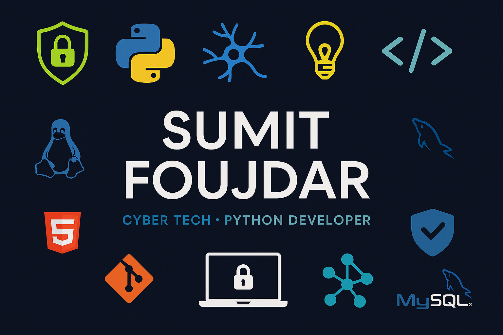

# 👋 Hi, I'm Sumit Foujdar

### 🔐 Cybersecurity Student | Python & Linux Learner | Aspiring Cybersecurity Professional

  

---

## 👨‍💻 About Me

I'm a B.Tech Computer Science and Engineering student specializing in **Cyber Security and Digital Forensics at VIT Bhopal**.

I'm passionate about technology, cybersecurity, and understanding how computer systems and networks work.

Currently, I'm building my technical foundation through programming, Linux environments, and hands-on learning.

- 🎓 B.Tech CSE – Cyber Security & Digital Forensics
- 🐍 Learning Python programming
- 🐧 Exploring Linux and Kali Linux
- 🔐 Interested in Cybersecurity and Information Security
- 🌐 Learning Computer Networking fundamentals
- 🛠️ Familiar with Git and GitHub
- 🚀 Focused on building practical projects
- 🎯 Goal: Grow into a skilled cybersecurity professional

---

## 🛠️ Technical Skills

### 💻 Programming Languages

  

### 🐧 Operating Systems

  
  

### 🔧 Tools & Technologies

  
  
  

---

## 📚 Currently Learning

- Python Programming Fundamentals
- Linux Commands and System Administration
- Computer Networking
- Cybersecurity Fundamentals
- Information Security
- Git and GitHub Workflows

---

## 🎯 Areas of Interest

  
  
  
  

---

## 📊 GitHub Statistics

  
  

  

---

## 🚀 Projects

I'm working towards building practical projects in Python, Linux, and Cybersecurity.

New projects and learning experiments will be added here as I complete them.

---

## 🤝 Connect With Me

  

  

  

---

## 💡 My Philosophy

### "Learn consistently. Build practically. Improve every day."

  

